# Andén

Reservá tu asiento, seguí tu bus en el mapa y hablá con tu chofer. App móvil para iOS y Android para los buses interlocales de Nicaragua: Managua, Boaco y Juigalpa.

  
   
  Teaser de 30 s grabado en un iPhone. Tocá la imagen para verlo.

## Para el pasajero

Preguntá por horarios y tarifas, reservá asiento y llevá tu boleto con QR. Cuando el chofer sale, seguís el bus en el mapa con la hora estimada de llegada.

<table>
  <tr>
    <td align="center">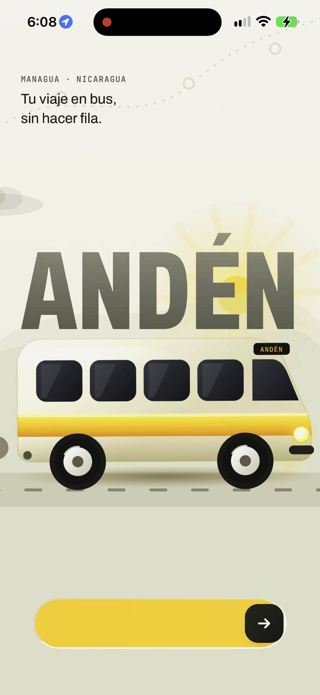 Bienvenida</td>
    <td align="center">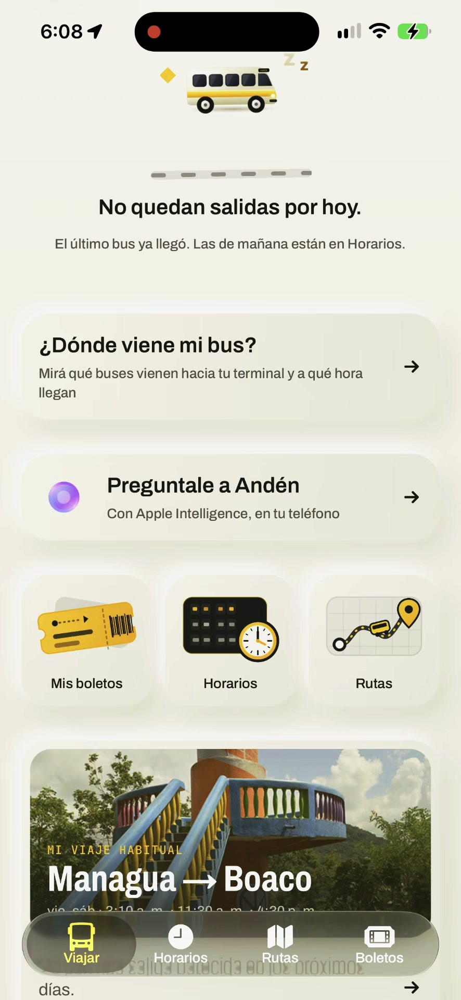 Inicio</td>
    <td align="center">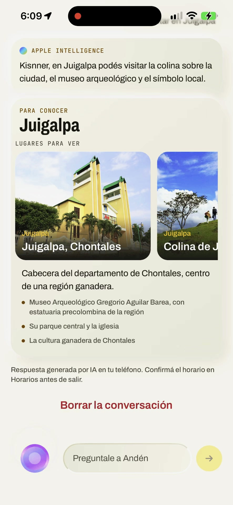 Preguntale a Andén</td>
    <td align="center">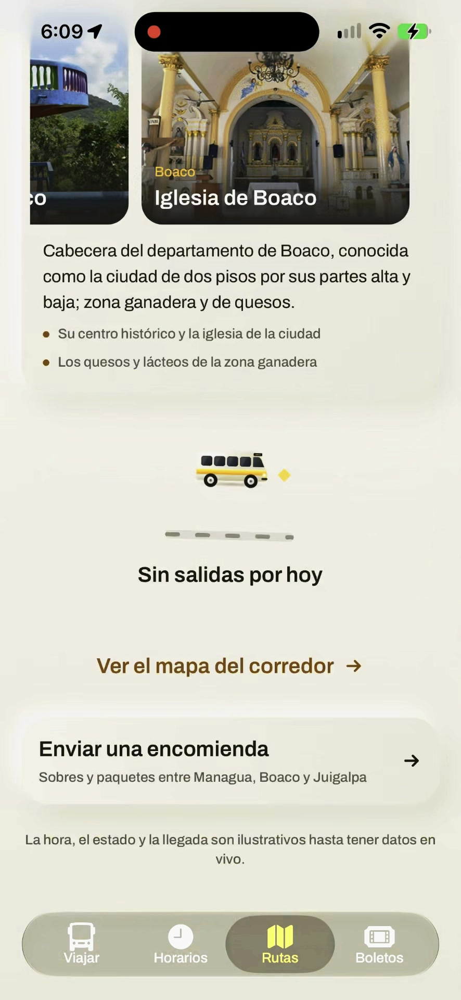 Ruta en el mapa</td>
  </tr>
  <tr>
    <td align="center">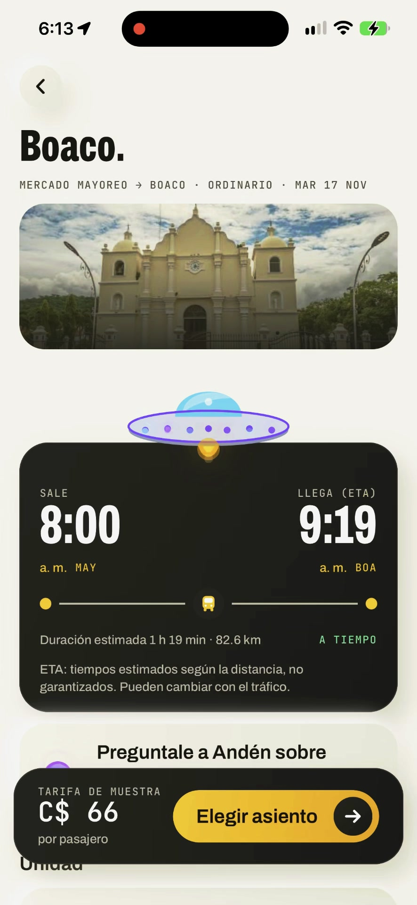 Detalle del viaje</td>
    <td align="center">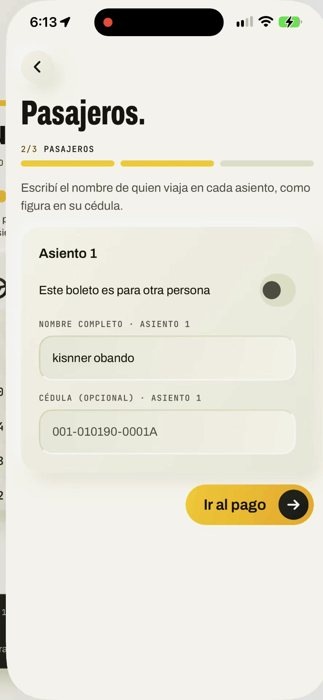 Elegir asiento</td>
    <td align="center">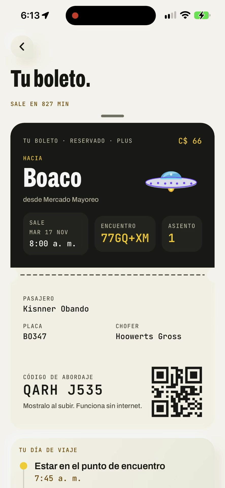 Boleto con QR</td>
    <td align="center">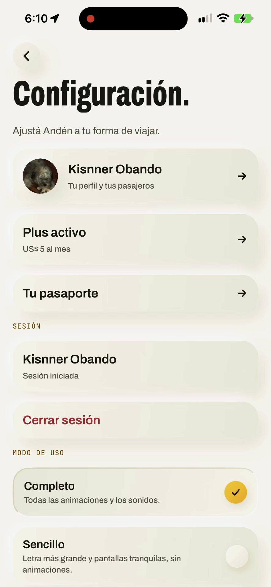 Pasaporte de viajes</td>
  </tr>
  <tr>
    <td align="center">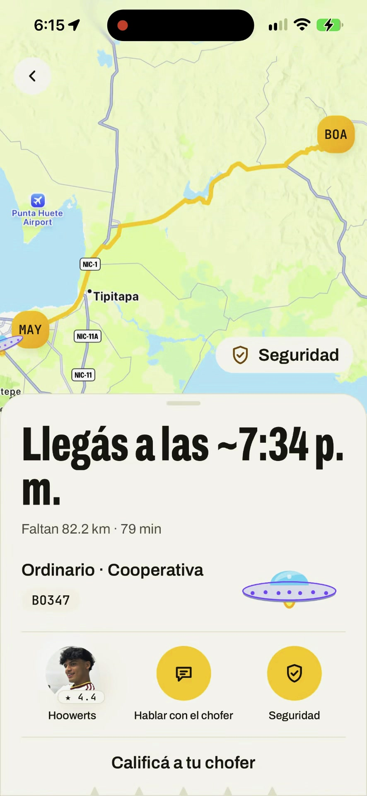 Viaje en curso</td>
    <td align="center">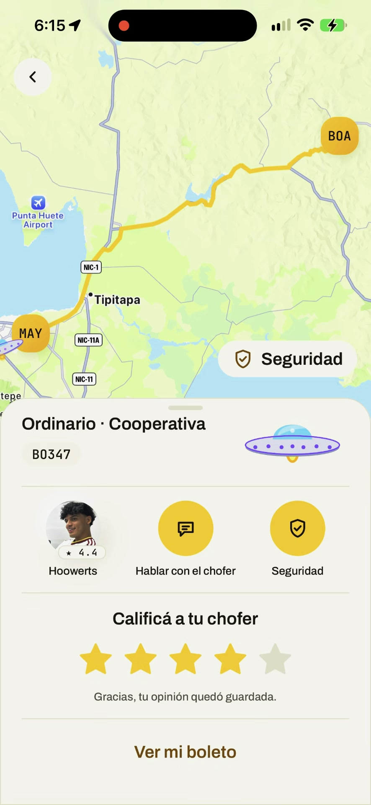 Calificar al chofer</td>
    <td align="center">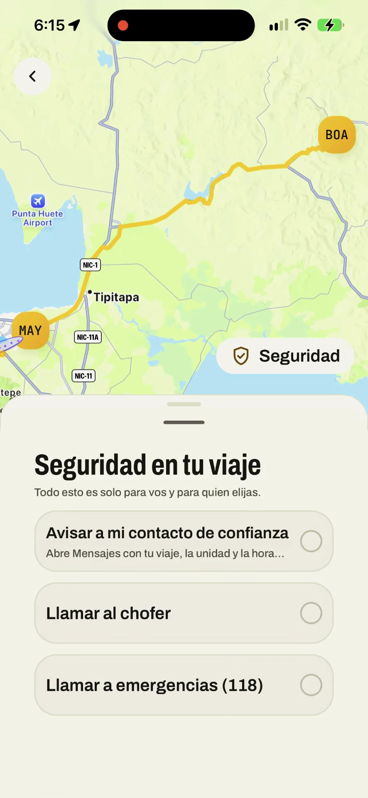 Seguridad</td>
    <td align="center">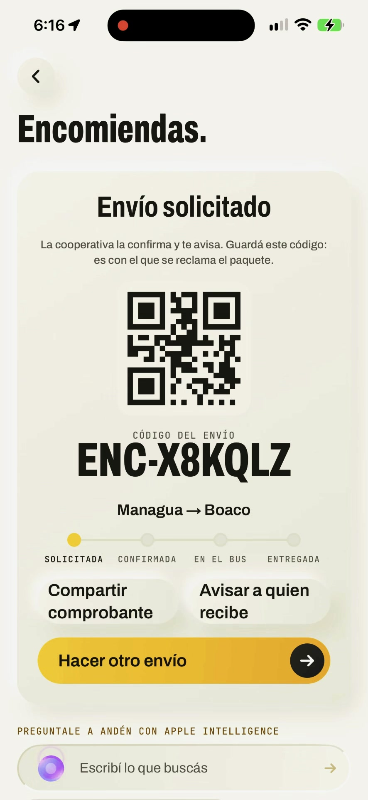 Encomienda</td>
  </tr>
</table>

## Para el conductor

Publicá tus viajes, escaneá el boleto de quien sube, compartí tu ubicación mientras manejás y cerrá el viaje con lo cobrado.

<table>
  <tr>
    <td align="center">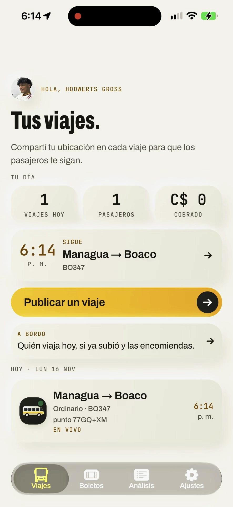 Inicio con el resumen del día</td>
    <td align="center"> Salida del viaje</td>
    <td align="center">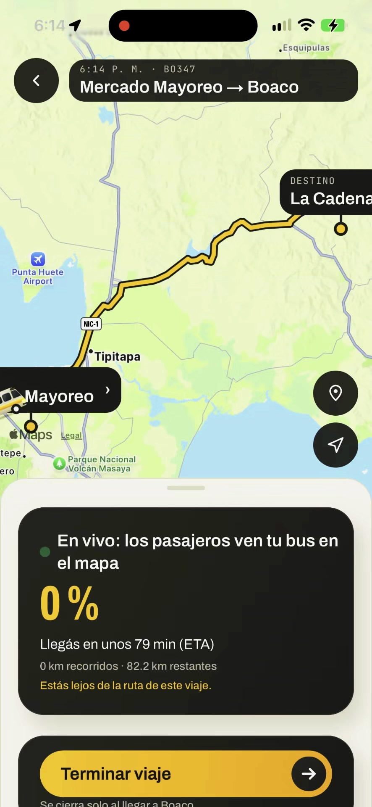 Mapa en vivo</td>
    <td align="center">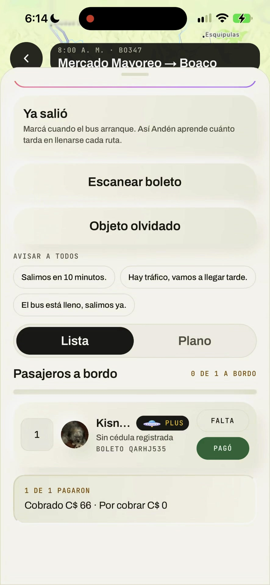 Pasajeros a bordo</td>
    <td align="center">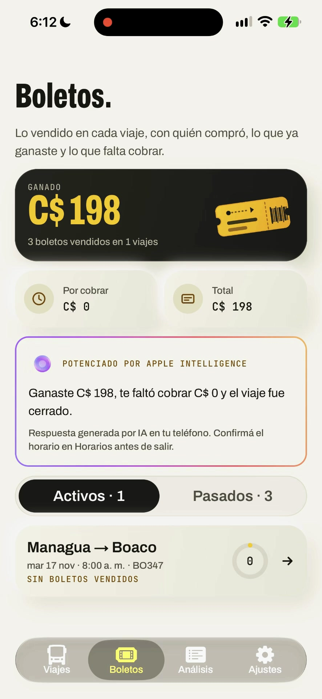 Ganancias</td>
  </tr>
</table>

## Paneles web

- **Cooperativa** (`apps/cooperativa`): viajes, conductores, solicitudes, finanzas, alertas de seguridad y una sección para preguntarle a Claude Code sobre la operación.
- **Red del asistente** (`apps/entrenador`): un laboratorio local para ver, entrenar y probar la red neuronal que contesta en el teléfono cuando no hay Apple Intelligence ni Gemini.

  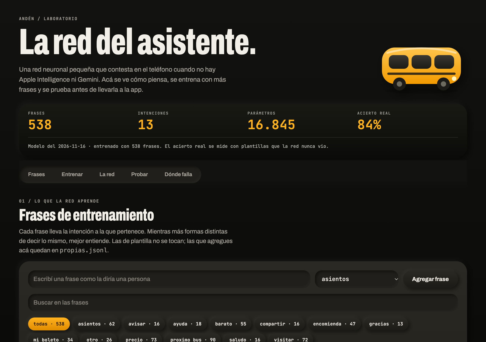

## Qué incluye

- **Reservas:** horarios por terminal, elegir asiento, pago al abordar, boletos con QR, reserva en grupo y transferir un boleto.
- **Viaje en curso:** mapa con el recorrido, hora estimada de llegada, la unidad y su placa, quién conduce, chat con el chofer (solo mientras el viaje va en camino), seguridad y calificación.
- **Asistente:** usa la IA del teléfono y, si no hay, una red neuronal propia con 13 intenciones y un 84 % de acierto medido con plantillas que nunca vio.
- **Seguridad:** detección de choques con aviso a un contacto de confianza y llamada a emergencias.
- **Conductor:** publicar y retirar viajes, pasajeros a bordo con escaneo, cierre con cobros, encomiendas y resumen del día.
- **Extras:** pasaporte de viajes, Andén Plus, modo simple con botones grandes y app para Apple Watch.
